<div align="center">


# Caveman marketing


</div>

<p align="center"></p>

**Your AI agent cuts any ad, landing page or signup to one picture, 15 words and one button.**

```bash
npx skills add lodar/caveman-marketing
```

Then tell your agent: **caveman my website**

<p align="center"><a href="assets/apple.png">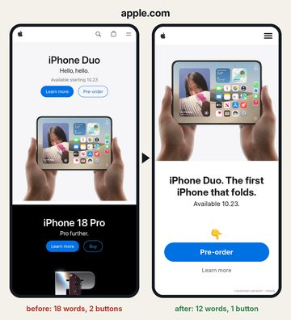</a><br>
<sub>The real apple.com on the left, the skill's version on the right.</sub></p>

## Use it for

Ads. Landing pages. Signups. Onboarding. App screens.

Anything people glance at for 3 seconds, then leave.

## The test

Look for 3 seconds, then cover the screen. Can you answer all three?

1. What is this?
2. Do I want it?
3. Where do I tap?

## The rules

1. A picture fills the top half.
2. 15 words max. Every word counts, buttons too.
3. One filled button, with 👇 above it. Nothing in the picture looks like a second one.
4. The button says what happens next.
5. A step bar on every step of a signup.
6. No words only your industry uses.
7. The signup ends when they get the thing.

`scripts/check.py` counts the words and buttons on each screen, because models miscount.
How the skill runs is in [SKILL.md](SKILL.md), and every example is in [examples/](examples/).

## Why it works

**One screen. One clear action. Minimum decisions before the user gets value.**

- **Hick's law** (Hick 1952, Hyman 1953). The time it takes to choose grows with the number of
  choices, roughly with log₂(n + 1). Every extra button slows the decision down.
- **Choice overload, the paradox of choice** (Iyengar & Lepper 2000, Schwartz 2004). With 6 jams
  on the table, 30% of the shoppers who stopped bought one. With 24, 3% did. It hits hardest when options are hard
  to compare and people don't know yet what they want (Chernev et al. 2015), which describes a
  stranger on your landing page.
- **Progressive disclosure.** Show only what this step needs, and reveal the rest later. That's
  why a signup asks one thing per screen.

## More examples

AI agents ran this skill on real pages. The real screen is on the left of each, the skill's version on the right.
Tap one to open it full size.

**Homepages on a phone.** Apple, HubSpot and Atlassian came from fresh agents that had only this skill.

<p align="center">
<a href="assets/hubspot.png">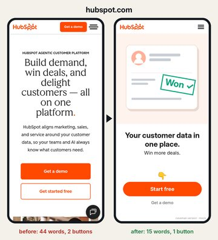</a>
<a href="assets/atlassian.png">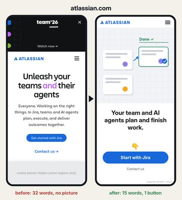</a>
<a href="assets/craigslist.png">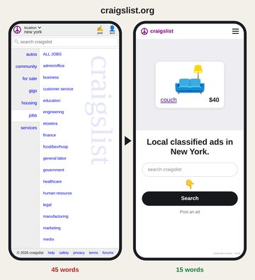</a>
<a href="assets/ryanair.png">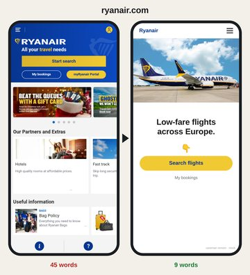</a>
</p>

**Facebook ads and a signup.** Real ads from Meta's Ad Library, same photo and same button. Salesforce's trial form becomes one thing per screen.

<p align="center">
<a href="assets/temu-ad.png">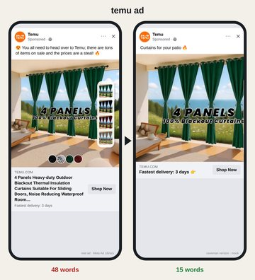</a>
<a href="assets/doordash-ad.png">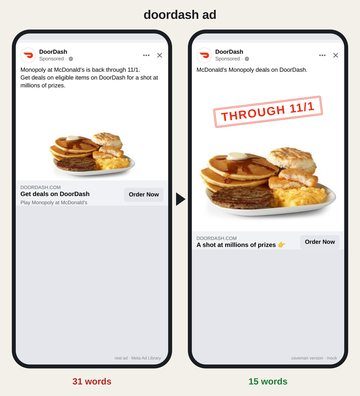</a>
<a href="assets/salesforce-signup.png">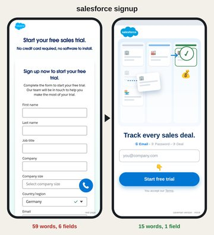</a>
</p>

**Desktop, 1440×900.** The picture takes the left half; the words and the one button sit on the right.

<p align="center">
<a href="assets/hubspot-desktop.png">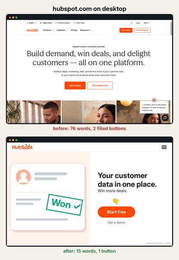</a>
<a href="assets/microsoft-desktop.jpg">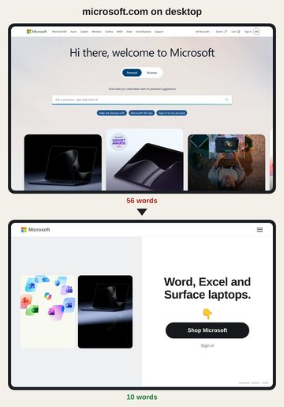</a>
<a href="assets/arngren-desktop.jpg">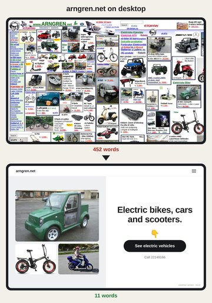</a>
</p>

<sub>The right-hand screens are mocks, not the companies' pages. Each keeps the company's own
claims. Pictures are the company's own photos, or drawings where the page had none. The ads are
real ads from Meta's Ad Library. Not affiliated with any company shown.</sub>

Made with [5dive](https://5dive.ai)'s AI agents.
